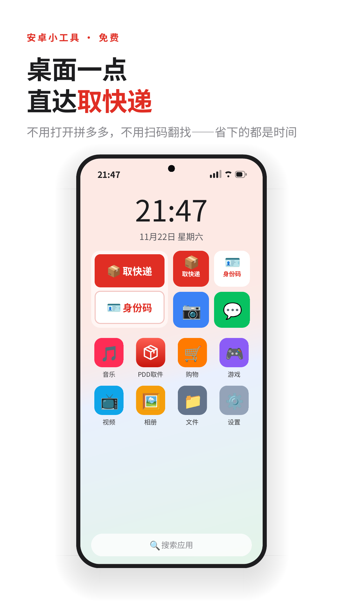
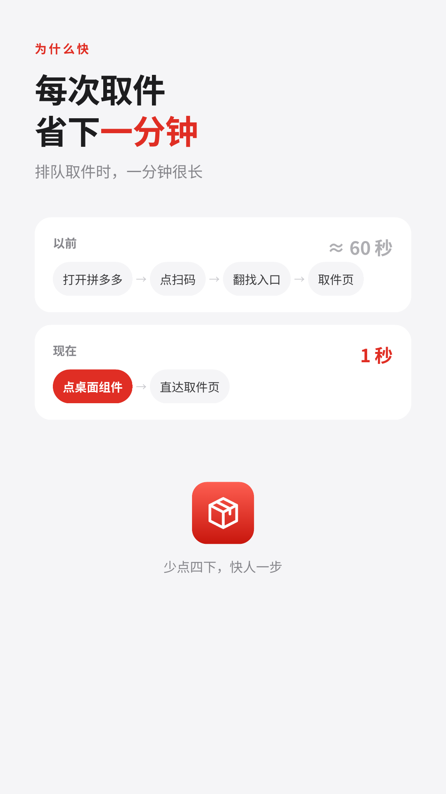
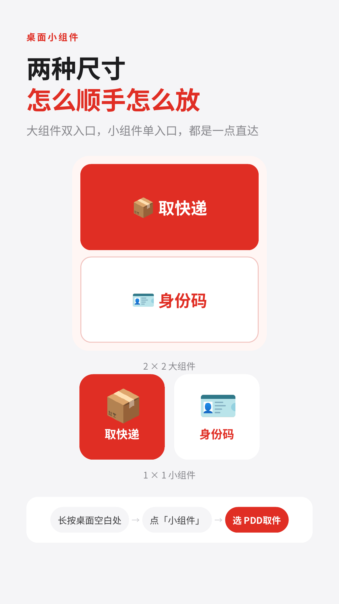
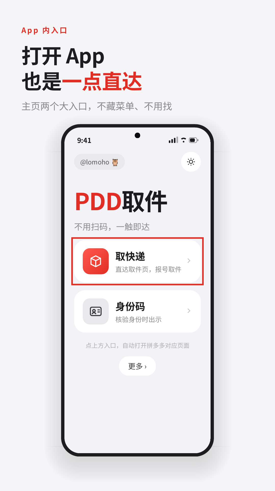
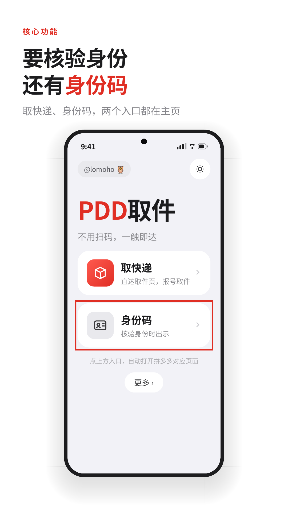
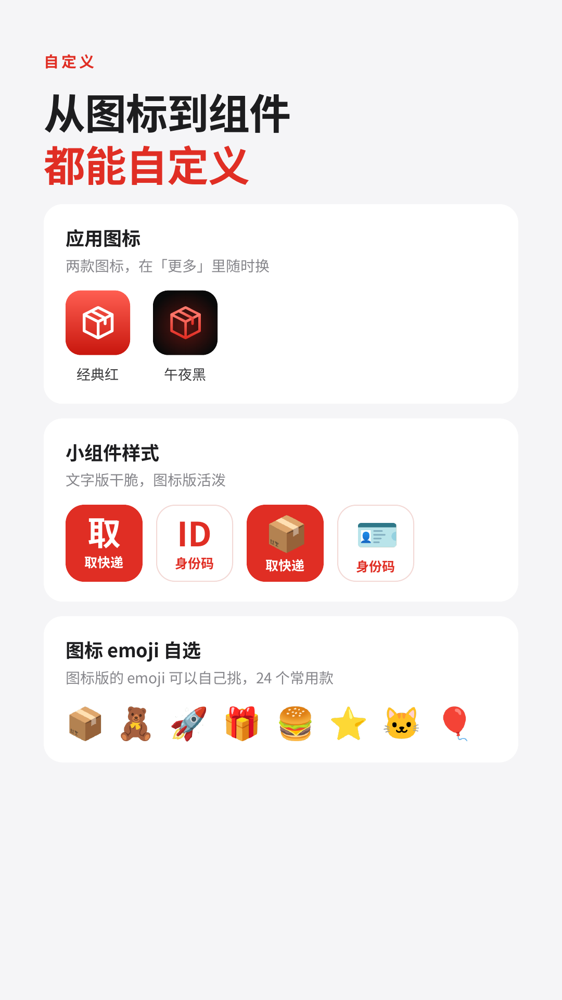
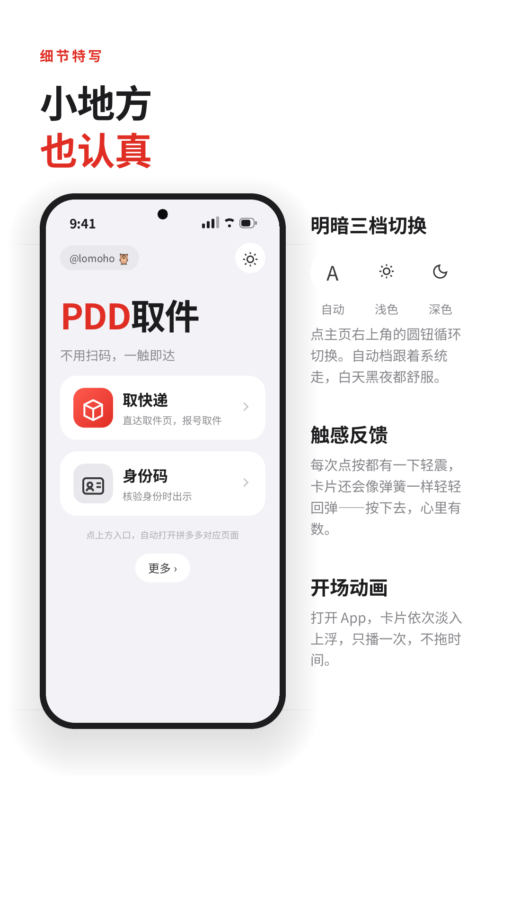
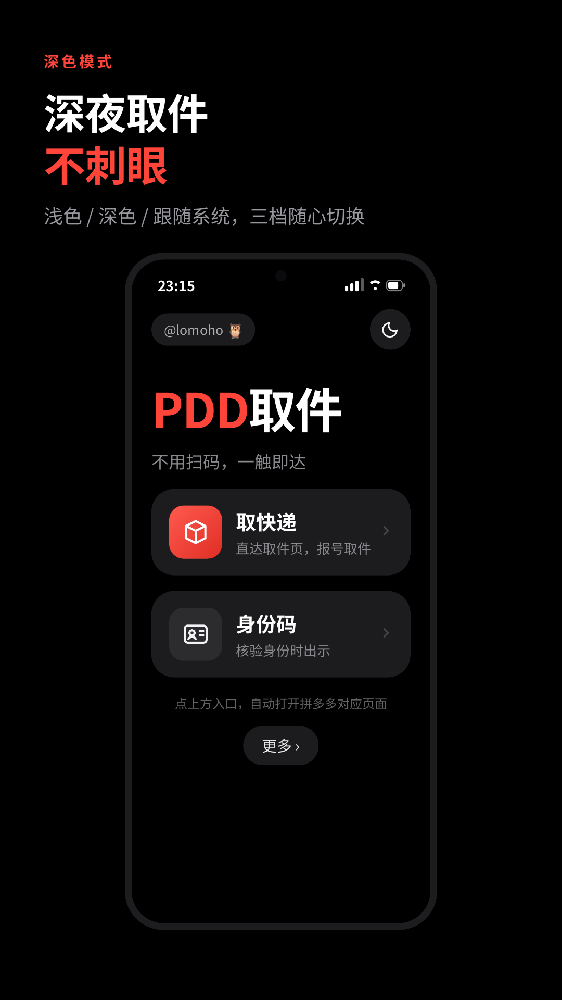
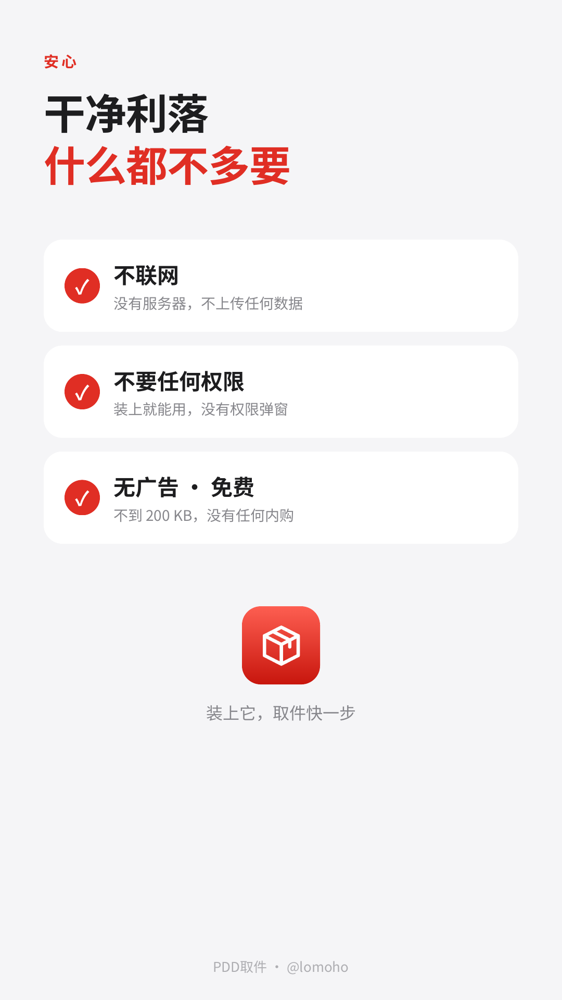

[](https://github.com/lomoho66/pdd-pickup)


# PDD取件

> 桌面一点，直达拼多多取件页 —— 零权限、不联网的安卓小工具

[](https://github.com/lomoho66/pdd-pickup/stargazers)
[](https://github.com/lomoho66/pdd-pickup/releases)
[](LICENSE)
[](https://t.me/lom0ho) [![LINUX DO](https://img.shields.io/badge/LINUX-DO-FFB003.svg?logo=)](https://linux.do)


<p>



</p>

## 这是什么

去驿站取件，每次都要打开拼多多、点扫码、再一层层翻到取件页 —— 路上就那么一分钟，全耗在翻 App 上了。

**PDD取件**把这一步搬到了桌面上：点一下桌面小组件（或 App 内的入口），直接打开拼多多的取件页 / 身份码页。以前约一分钟的翻找，现在一秒到位。

它不生成任何码，也不读取任何数据 —— 只是通过拼多多对外暴露的深链，把 App 打开到对的那一页。

## 功能

- **桌面小组件** —— 2×2 双入口 / 1×1 单入口，点一下直达取件页或身份码页
- **App 内双入口** —— 取快递、身份码，两个大入口都在主页，不藏菜单
- **长按图标快捷菜单** —— 长按桌面图标，选「取件页 / 身份码」直达
- **小组件双风格** —— 文字版（固定的「取」/「ID」）与图标版，图标版的 emoji 可自选（72 个快递主题精选）
- **应用图标可换** —— 经典红 / 午夜黑两款
- **明暗三档** —— 自动 / 浅色 / 深色，主页右上角圆钮一键循环切换
- **触感反馈** —— 每次点按都有轻震与弹簧回弹动画
- **干净利落** —— 零权限、不联网、无广告、无内购，安装包不到 200 KB

## 界面预览

| 桌面一键直达 | App 内入口 | 身份码 |
|:---:|:---:|:---:|
|  |  |  |

| 小组件 | 自定义 | 细节 |
|:---:|:---:|:---:|
|  |  |  |

| 深色模式 | 安心三承诺 | 为什么快 |
|:---:|:---:|:---:|
|  |  |  |

## 下载与安装

1. 前往本仓库的 **Releases** 页下载最新版 APK，直接安装（需允许「安装未知应用」）
2. 系统要求：Android 8.0 及以上；需已安装拼多多 App
3. 添加小组件：长按桌面空白处 →「小组件」→ 找到 **PDD取件**，拖到桌面即可

## 工作原理

核心是拼多多 App 对外暴露的深链（scheme），配合四级兜底，保证尽量打开到对的页面：

1. 深链直达目标页（取件页 / 身份码页）
2. 个别 ROM 对包名有限制时，去掉包名再试一次
3. 至少打开拼多多首页
4. 网页版兜底

实现见 [`PddLinks.java`](app/src/com/lomoho/pddpickup/PddLinks.java)，跳板与震动反馈见 `JumpActivity` / `WidgetJump`。

## 从源码构建

本项目**不用 Gradle**，用一条手工打包链（aapt2 → javac → d8 → zipalign → apksigner），构建过程完全透明。

环境要求：

- JDK 17
- Android SDK：platform 34、build-tools 34.0.0

```bash
export JAVA_HOME=/path/to/jdk17
export ANDROID_HOME=/path/to/android-sdk
./build.sh
# 产物：PDDPickup.apk
```

签名说明：默认自动生成本地 debug 证书（`debug.keystore`，已在 .gitignore 中排除）；如需正式签名，设置环境变量 `KEYSTORE_FILE` / `KEYSTORE_PASSWORD` / `KEY_ALIAS` 后再运行脚本。

## 项目结构

```
.
├── app/
│   ├── AndroidManifest.xml
│   ├── src/com/lomoho/pddpickup/   # 全部 Java 源码（无第三方依赖）
│   └── res/                        # 布局、图标、小组件预览图等资源
├── docs/images/                    # 介绍图
├── build.sh                        # 手工打包脚本
├── CHANGELOG.md
└── LICENSE
```

## 免责声明

本项目为个人开发的学习工具，**与拼多多官方无关**；「PDD」「拼多多」为其权利方的商标。所用深链为拼多多 App 对外暴露的公开 scheme，若官方调整接口，相关功能可能失效。

## 作者

**@lomoho** —— 酷安 / GitHub 同名

如果这个小工具帮你省了时间，欢迎请作者喝杯咖啡 ☕

<a href="https://afdian.com/a/lomoho"></a>

（点击图片前往爱发电）

## 许可证

[GPL-3.0](LICENSE) © 2026 lomoho

## 📈 Star History

<a href="https://star-history.com/#lomoho66/pdd-pickup&Date">
  <picture>
    <source media="(prefers-color-scheme: dark)" srcset="https://api.star-history.com/svg?repos=lomoho66/pdd-pickup&type=Date&theme=dark" />
    <source media="(prefers-color-scheme: light)" srcset="https://api.star-history.com/svg?repos=lomoho66/pdd-pickup&type=Date" />
    
  </picture>
</a>
