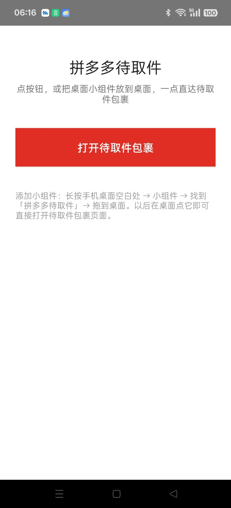

# 拼多多取件码

一个小工具：点一下，直达待取件包裹。无广告、不联网、不要权限。

给拼多多重度用户的小捷径：桌面放一个 2×2 小组件，点一下直接打开拼多多 App 内的「待取件包裹」页面，省去打开 App 后再层层点进去的步骤。

## 功能

- 桌面小组件（2×2）：一点直达拼多多待取件包裹页
- App 内一个大按钮，同等功能
- 跳转失败自动兜底：深链打不开 → 拉起拼多多首页 → 再兜底打开网页版
- 零权限、零后台、零联网请求，安装包约 25 KB

## 截图



## 原理

利用拼多多 App 对外暴露的标准深链（URL Scheme）跳转：

| 功能 | 深链 |
| --- | --- |
| 待取件包裹 | `pinduoduo://com.xunmeng.pinduoduo/mdkd/package?entry_source=11` |
| 取件码 | `pinduoduo://com.xunmeng.pinduoduo/mdkd/package?tab=ID_CODE&entry_source=11` |

小组件点击后经一个透明跳板 Activity 发起 `ACTION_VIEW` 跳转，随即自毁，不留界面。

## 安装

1. 到本仓库的 Releases 下载 `PddPickup.apk`，或按下方说明自行构建
2. 在安卓手机上打开安装（需允许「安装未知应用」）
3. 打开一次 App，长按桌面空白处 → 小组件 → 找到「拼多多取件码」→ 拖到桌面
4. 使用前提：手机已安装并登录拼多多 App

系统要求：Android 8.0（API 26）及以上。

## 自行构建

本项目**不用 Gradle**，是一条手工流水线脚本（aapt2 → javac → d8 → zipalign → apksigner），干净透明：

依赖：

- JDK 17（`JAVA_HOME`，缺省 `~/jdk17`）
- Android SDK（`ANDROID_SDK_ROOT`，缺省 `~/android-sdk`），含 `platforms/android-34` 与 `build-tools/34.0.0`

```bash
./build.sh
# 产物：PddPickup.apk
```

首次构建会在本地生成签名密钥 `release.keystore`（口令存 `keystore-password.txt`），两者都已被 `.gitignore` 排除，**请勿上传到任何公开仓库**；后续升级必须用同一把密钥签名才能覆盖安装。

## 目录结构

```
├── AndroidManifest.xml
├── build.sh            # 构建脚本
├── src/com/lomoho/pddpickup/
│   ├── MainActivity.java    # 主界面（含关于卡片）
│   ├── PickupWidget.java    # 桌面小组件
│   ├── JumpActivity.java    # 透明跳板
│   └── PddLinks.java        # 深链与兜底跳转逻辑
├── res/                # 布局、图标、字符串
└── docs/               # 截图
```

## 免责声明

- 本项目为个人开源小工具，与拼多多官方**无关**，未获其授权或背书；「拼多多」为其注册商标，此处仅作功能说明的指称使用。
- 深链为拼多多 App 对外暴露的公开跳转接口；若拼多多改版调整该接口，本工具可能失效，欢迎提 Issue 或 PR 更新地址。

## 作者

酷安 @LOMOHO

## 致谢

Muse by Meta

## 许可证

[MIT](LICENSE)
